<div align="center">

# Your next rotation. Fewer detours.

**A Foot Locker UI design study for discovery, confidence, and revenue growth.**

[Explore the live demo](https://footlocker-ui-study-pcteja.netlify.app) · [Read the pitch deck](#pitch-deck) · [View every frame](https://footlocker-ui-study-pcteja.netlify.app/gallery.html) · [Design decisions](designs-v2/README.md) · [Asset sources](designs-v2/asset-sources.json)

**Original imagery · Responsive layouts · Athlete filtering · Quick shop**

</div>

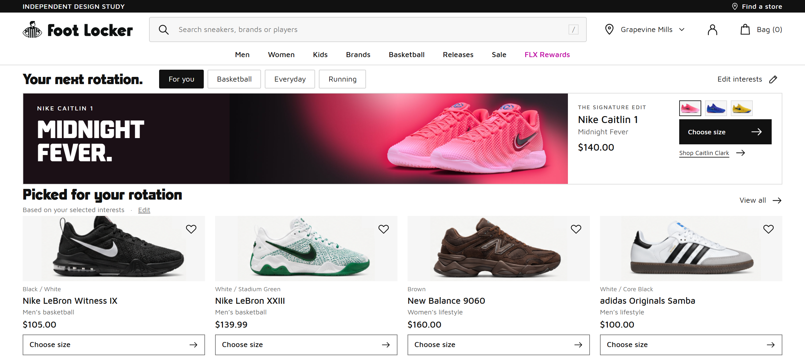

> **Independent design study, not an official Foot Locker storefront.** This repository demonstrates a shopping interface and a plan to test its commercial impact. It does not collect payments, place orders, connect to live inventory, or claim measured revenue gains. Foot Locker and product-brand assets belong to their respective owners.

## Pitch deck

**Does user experience improve growth?** A visual walkthrough of the purchase journey, desktop and mobile redesigns, and the growth hypothesis.

<div align="center">

<a href="docs/pitch-deck/Foot-Locker-Pitch-Deck.pdf">
  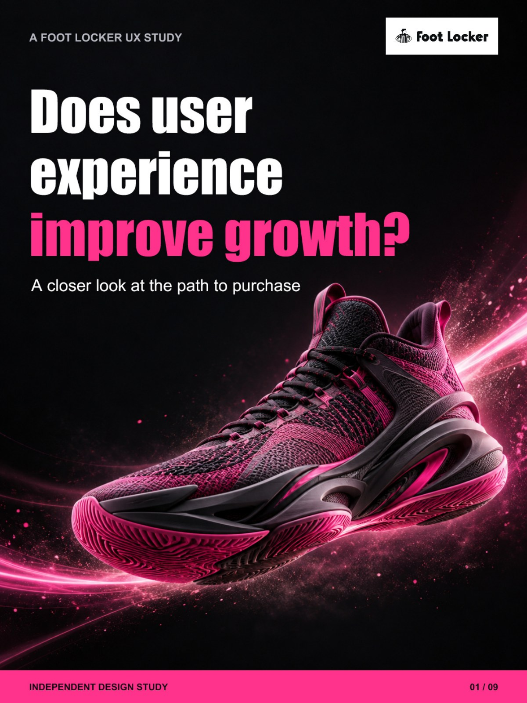
</a>

**[Read the PDF →](docs/pitch-deck/Foot-Locker-Pitch-Deck.pdf)** · [Download PDF ↓](docs/pitch-deck/Foot-Locker-Pitch-Deck.pdf?raw=true)

9 slides · Portrait format · PDF, 3.9 MB

</div>

### Browse without leaving the README

Expand a slide below to read its preview and summary. Select any preview to open the full-size image; use **Read the PDF** above for the complete deck.

<details>
<summary><strong>01 · The question</strong> — Does user experience improve growth?</summary>

A closer look at the path to purchase. This independent design study explores how a clearer shopping experience could support growth.

[](docs/pitch-deck/slide-1.jpg)

</details>

<details>
<summary><strong>02 · The purchase journey</strong> — A shorter path to the next pair</summary>

The proposed flow has three stages: find your pair, choose your size, and review your bag. The “almost 9 → 3” comparison is an illustrative journey, not verified click counts. The prototype stops before payment; total clicks need validation using the same start and end points.

[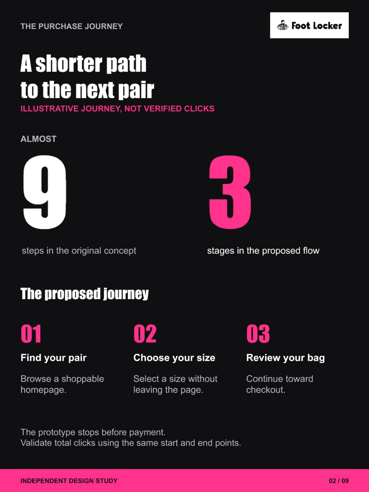](docs/pitch-deck/slide-2.jpg)

</details>

<details>
<summary><strong>03 · Desktop homepage</strong> — The homepage, ready to shop</summary>

Compare the campaign-led original capture with a compact, shoppable hero and recommendations brought into the first screen.

[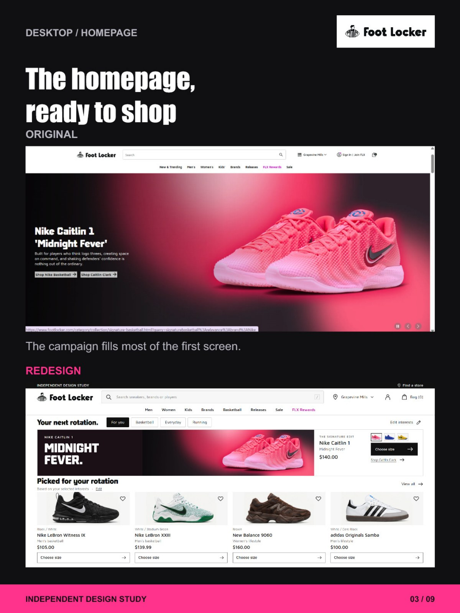](docs/pitch-deck/slide-3.jpg)

</details>

<details>
<summary><strong>04 · Desktop discovery</strong> — The assortment stays in view</summary>

Large athlete portraits become compact filters, keeping the selected player and product assortment together.

[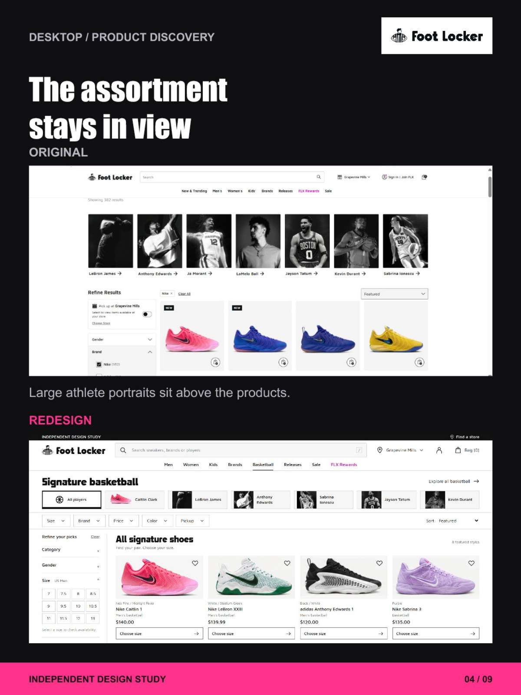](docs/pitch-deck/slide-4.jpg)

</details>

<details>
<summary><strong>05 · Mobile homepage</strong> — The mobile comparison</summary>

The redesigned mobile homepage brings the price, size action, and recommendations into view. These are cropped captures with different viewport and scroll positions, illustrating hierarchy rather than a controlled comparison.

[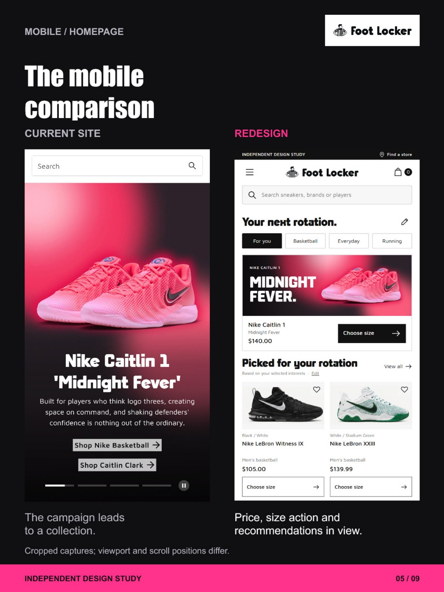](docs/pitch-deck/slide-5.jpg)

</details>

<details>
<summary><strong>06 · Mobile discovery</strong> — Athlete discovery, with products in view</summary>

Compact athlete filters sit above the products so shoppers can explore a player's assortment in place. The captures have different viewport and scroll positions.

[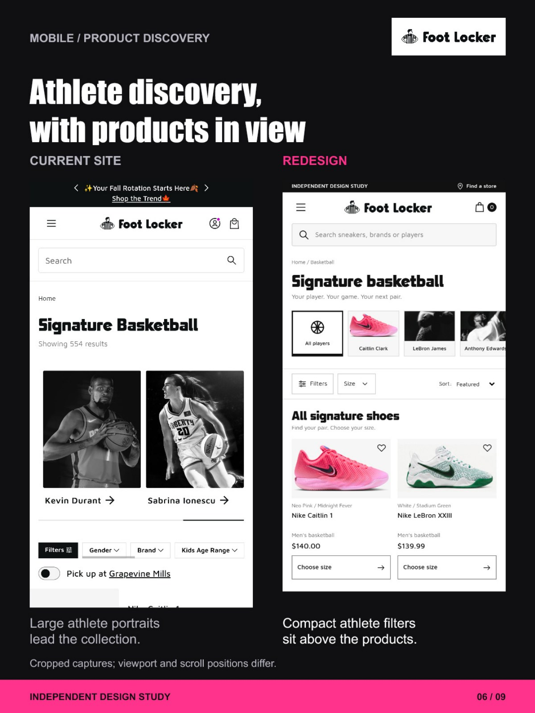](docs/pitch-deck/slide-6.jpg)

</details>

<details>
<summary><strong>07 · Mobile product details</strong> — Product details stay close</summary>

The redesigned homepage exposes the price and size action; quick shop keeps the product and color visible while choosing. The two redesign crops show separate interface states.

[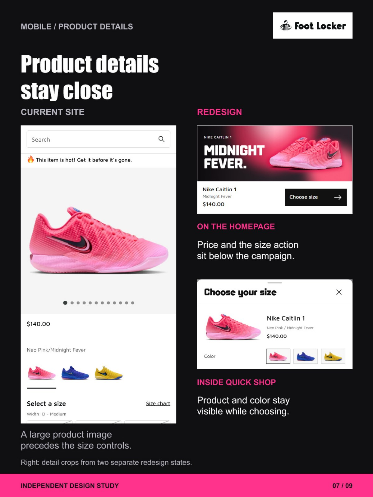](docs/pitch-deck/slide-7.jpg)

</details>

<details>
<summary><strong>08 · Choosing a size</strong> — The choice stays with the product</summary>

Compare a separate product page with an in-page sheet that brings the product, size selection, and action together. Displayed sizes illustrate the prototype; availability is not connected to live inventory.

[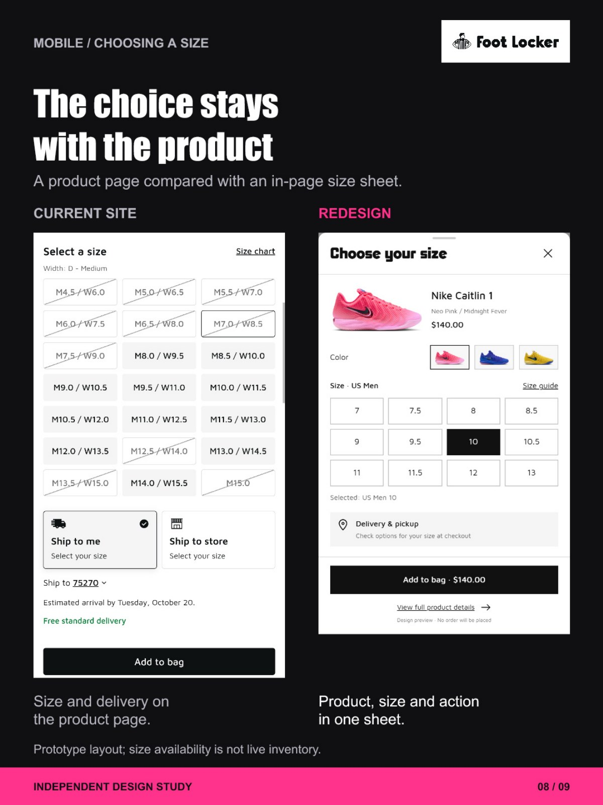](docs/pitch-deck/slide-8.jpg)

</details>

<details>
<summary><strong>09 · The growth hypothesis</strong> — Better UX. Growth to prove.</summary>

A clearer route may help shoppers reach a confident purchase. Test task completion, purchase conversion, and revenue per session in a controlled experiment. Commercial impact remains unmeasured.

[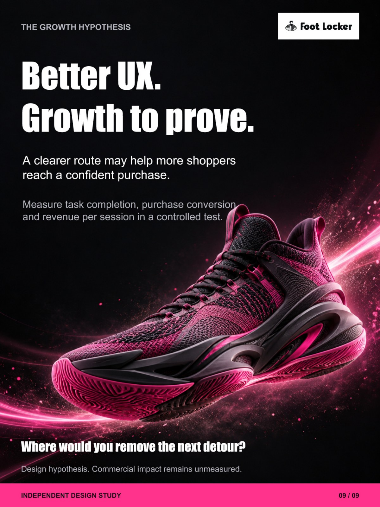](docs/pitch-deck/slide-9.jpg)

</details>

Continue into the case study below for the evidence, revenue assumptions, and validation plan.

## The opportunity

The supplied website captures show a large campaign occupying the first screen, recommendations further down, and another large athlete-selection area before the basketball assortment. The brand story is strong; the shopper has to travel further to inspect a shoe and choose a size.

The redesign keeps Foot Locker's sneaker identity and minimal product grid, then brings the product, price, and size action closer together. The purpose is to reduce unnecessary navigation and uncertainty while preserving thoughtful exploration. It does not equate fewer clicks with automatically better usability. [NN/g explains why the three-click rule is not a reliable usability measure.](https://www.nngroup.com/articles/3-click-rule/)

## Before → after

| Supplied experience | Revised experience |
|:---|:---|
| 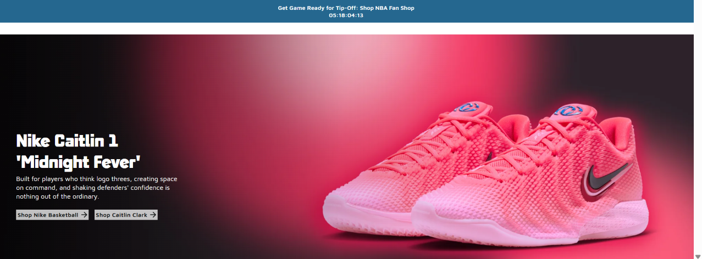 |  |
| Campaign dominates the initial capture. Product recommendations require scrolling. | Compact campaign with a price and direct size action; four recommended products and their actions fit in a 1280 × 580 viewport. |
| 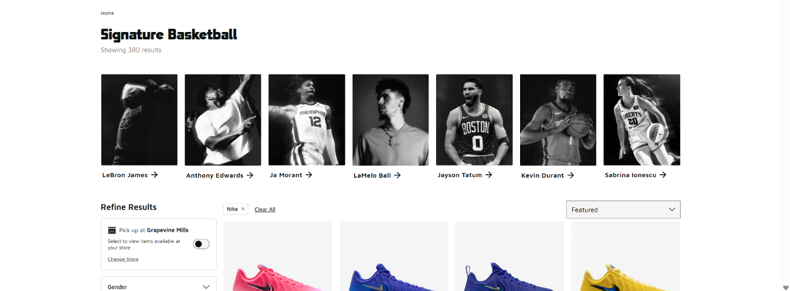 | 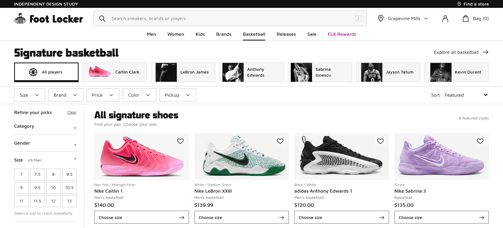 |
| Large athlete portraits separate the heading from the product grid. | Compact athlete filters update the grid in place; the selected player remains visible. |

The “before” images are crops of the user-supplied captures; account headers are omitted. They are evidence of the supplied journey, not a fresh audit of every current Foot Locker page. The “after” images are renders of this prototype. Different capture dimensions mean these comparisons illustrate hierarchy rather than a controlled usability experiment.

| Design decision | Shopper benefit | Business hypothesis to test |
|---|---|---|
| Shoppable, compact hero | Inspect the featured shoe and choose a size immediately | More qualified product engagement and successful adds |
| Product row in the first viewport | Compare recommendations without an initial scroll | More discovery of relevant alternatives |
| Player selection as a filter | Explore an athlete's models without losing the assortment | Less abandonment between collection and product discovery |
| “Choose size” on each product | Clear next action with required fit decisions | More successful adds without sacrificing size accuracy |
| Editable interests | Explain and control recommendation relevance | Higher revenue per session through useful discovery |
| Two-column mobile grid and size sheet | Scan products and act within the same page context | Better task completion on smaller screens |
| Campaigns after products | Retain brand/editorial identity without dominating shopping | Balance product discovery with longer-term brand engagement |

These are hypotheses. None establishes an uplift without measurement.

## The business target: 12% → at least 20% revenue growth

**This is a revenue-growth target, not a conversion-rate target.** The 12% baseline and 20% ambition were supplied for the project brief; they have not been validated against a business analytics dataset. Use the same reporting period, currency, scope, and net-revenue definition for both.

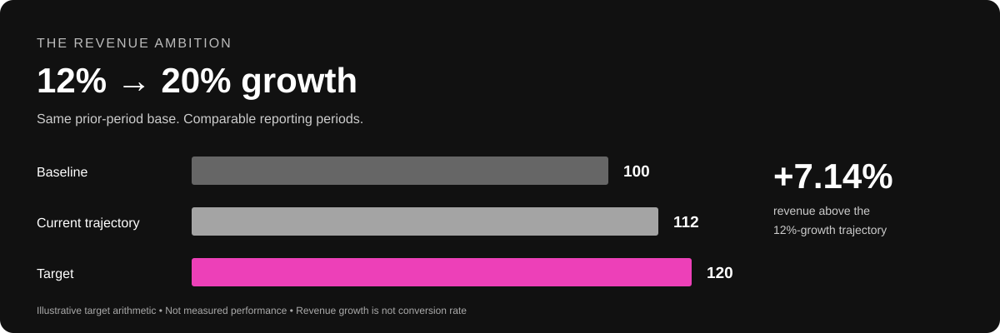

| Scenario, relative to the same prior-period base | Revenue index | Growth vs. prior period |
|---|---:|---:|
| Prior comparable period | 100 | — |
| Assumed current trajectory | 112 | 12% |
| Target trajectory | 120 | 20% |
| Increment needed above the current trajectory | **8** | **+8 percentage points of growth** |

The revenue level must rise by **120 ÷ 112 − 1 = 7.14%** above the 12%-growth trajectory to reach 20% growth. The growth *rate* is 66.7% larger (20 ÷ 12 − 1), but that is **not** a requirement for 66.7% more revenue. For an illustrative prior-period revenue of $1,000,000, the scenarios are $1,120,000 and $1,200,000: an $80,000 gap.

The website can influence only part of that outcome. A useful decomposition is:

```text
Net revenue = eligible sessions × completed-order conversion × net revenue per order

Target at constant traffic:
conversion multiplier × net-revenue-per-order multiplier ≥ 1.071429

Illustrative arithmetic, not a forecast:
1.04 × 1.031 = 1.07224  →  7.224% more revenue
112 × 1.07224 = 120.09088  →  20.09% growth vs. the common base
```

The illustration combines a 4% relative conversion improvement with a 3.1% relative improvement in net revenue per order. It assigns neither effect to this UI. A constant-traffic scenario isolates the shopping experience; actual growth also depends on acquisition, seasonality, price, promotions, product availability, returns, and other changes. Higher revenue also does not guarantee higher profit. Track contribution margin and discount cost alongside sales.

### How the design could contribute

1. **Reduce avoidable drop-off.** Bring recommendations and size actions into view; test whether more eligible visitors complete purchases.
2. **Increase relevance.** Let shoppers select a player or interest; test whether they find appropriate products more reliably.
3. **Support considered trade-ups.** A future comparison can explain why a higher-priced model fits a stated performance need. Do not rank solely by price or infer that every shopper wants a premium shoe.
4. **Protect trust and margin.** Keep sizing explicit, show authentic product photography, and avoid forced bundles. Optional accessories belong after the primary selection, with transparent prices and no preselection. The current prototype does not implement accessory recommendations or feature-based trade-ups.

## Evidence behind the direction

| Research or business context | Application here | Limit of the evidence |
|---|---|---|
| [Baymard: responsive upscaling](https://baymard.com/research-articles/responsive-upscaling) | Keep promotional imagery from displacing useful product content | Does not prescribe this hero height or establish its revenue impact |
| [Baymard: applied filters](https://baymard.com/research-articles/how-to-design-applied-filters) | Show the selected athlete and resulting assortment clearly | Athlete filtering is this project's application of the principle |
| [Baymard: quick views](https://baymard.com/research-articles/mobile-desktop-quick-views) | Retain list context while exposing size/color selection | Footwear shoppers may still need a full product page for fit and performance details |
| [NN/g: customization vs. personalization](https://www.nngroup.com/articles/customization-personalization/) | Explain recommendations and make interests editable | A relevance engine requires actual catalog and preference data |
| [Foot Locker: FLX and digital shopping announcement, June 2024](https://investors.footlocker-inc.com/news-releases/news-release-details/foot-locker-reimagines-sneaker-shopping-experience-flx-rewards) | Retain sneaker culture while improving discovery and shopping convenience | Company strategy is context, not evidence of this concept's effectiveness |

## Validation plan

**First validate usability.** Include smaller laptops, mobile shoppers, first-time visitors, returning visitors, and keyboard users. Ask them to find a preferred player's shoe, inspect details, choose a size, handle an unavailable size in an inventory-connected version, and return to the assortment. Record task success, wrong-size selections, time to a suitable product, and loss of context.

**Then run a controlled experiment on a real commerce implementation.** Randomize eligible users consistently between the existing experience and the revised experience. Keep acquisition and promotional conditions comparable. Define eligibility, attribution window, refund adjustment, stopping rules, and exclusions before the test.

| Measurement | Role |
|---|---|
| Net revenue per eligible session | Primary experiment outcome; at constant traffic, the growth scenario requires approximately +7.14% |
| Completed purchases per eligible session | Diagnoses purchase completion |
| Net revenue per order | Diagnoses basket value after discounts and the chosen refund treatment |
| Product engagement and successful add-to-bag rate | Funnel diagnostics, not substitutes for revenue |
| Contribution margin per eligible session | Checks whether revenue gains translate into commercial value |
| Returns, cancellations, size-related returns, checkout abandonment | Guardrails against misleading short-term gains |
| Mobile/desktop performance and accessibility task success | Experience guardrails |

Use actual baseline variance and a chosen minimum detectable effect to calculate sample size; no universal sample size or fixed test duration is justified here. Run through representative business cycles and allow the agreed returns window to mature. Report effect sizes and uncertainty. An observed point estimate of +7.14% alone is insufficient to claim the target confidently; the decision rule must account for uncertainty and guardrails. Validate actual period-over-period revenue growth separately from the experiment's causal effect.

Proposed events are `view_assortment`, `select_player`, `open_quick_shop`, `select_variant`, `select_size`, `add_to_cart_success`, `begin_checkout`, `purchase`, and `refund`. Deduplicate purchases by order ID and reconcile to the revenue source of truth. The public prototype sends **no analytics or purchase events**.

## Responsive design, with visible actions

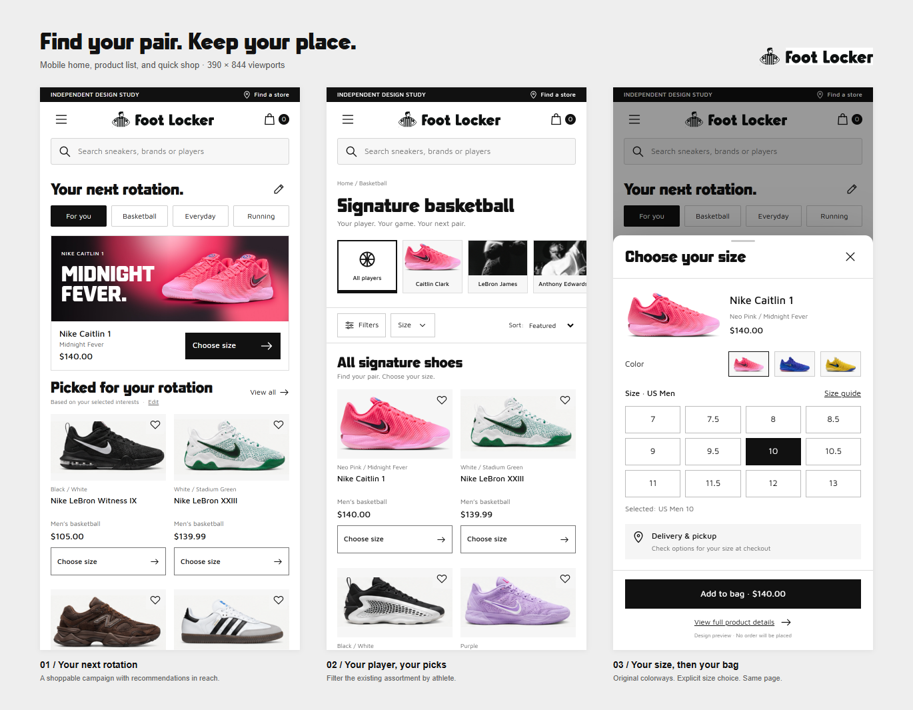

| Checked viewport | Homepage first-row action bottom | Listing first-row action bottom |
|---|---:|---:|
| 1280 × 580 | 566px | 569px |
| 1280 × 720 | 687px | 701px |
| 390 × 844 | 732px | 699px |
| 360 × 740 | 732px | 699px |

These are CSS browser viewports, excluding browser chrome. The gallery also includes 1024px and 1440px widths and full-page views. Automated checks found no document-level horizontal overflow at the recorded viewports. The mobile athlete row intentionally scrolls horizontally. Native dialogs, focus styling, and a skip link are included; a full accessibility audit remains necessary.

## What works in the demo

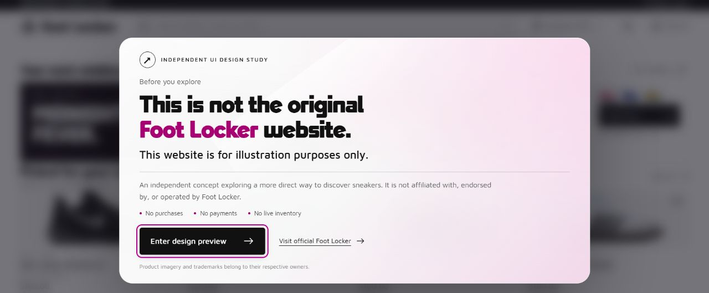

- A large opening disclaimer over a frosted-glass overlay, shown once per browser session and available again from “About this demo.” It clearly separates this illustration from the official store.
- Responsive home, product list, and quick-shop views.
- Athlete filtering, preview-assortment search, and price sorting.
- Original Caitlin colorway switching and explicit size selection.
- A browser-session preview bag with item removal; no checkout or payment collection.
- Saved-card state within the session and simple home interest category switches.
- A gallery containing 14 rendered frames and the original-image source manifest.

**Boundaries:** inventory, shipping, taxes, discounts, account sign-in, full preference-based ranking, detailed size/brand/price filters, and checkout are not connected. Displayed sizes demonstrate the interface, not stock availability. Reference products are not a complete current catalog. Search covers the displayed signature assortment. Category navigation explains the prototype's scope.

## Product imagery and provenance

The Caitlin hero and pink, blue, and yellow product images are official Foot Locker assets. The Midnight Fever model is H7423600 / IH7423-600; its displayed $140 price was checked against [Foot Locker's product page](https://www.footlocker.com/product/~/H7423600.html). Prices can change.

Other shoe images are preserved crops from the supplied design references. They have not been independently authenticated against every current SKU; their names and prices are reference snapshots. Player photos come from the supplied original Foot Locker screenshot. Caitlin's tab uses the verified shoe photograph. No shoes were generated or redrawn in this revision. Crops and background cleanup are documented in [the manifest](designs-v2/asset-sources.json).

Third-party logos, product photographs, and fonts retain their owners' rights and are not offered under an open-source asset license. This is an independent design demonstration. Reuse in a commercial store requires the appropriate rights and live catalog data.

## Run locally

Node.js 20 or newer is sufficient. There are no application dependencies to install.

```bash
npm run check
npm run build
npm start
```

Open `http://127.0.0.1:4173`. Product list: `/?page=listing`. Frame gallery: `/gallery.html`. Pitch deck: `/docs/pitch-deck/Foot-Locker-Pitch-Deck.pdf`.

## Deploy to Netlify

The repository includes [netlify.toml](netlify.toml):

```toml
[build]
  command = "npm run check && npm run build"
  publish = "dist"
```

Connect the repository to Netlify and use the project configuration in Git. The dependency-free build copies only the intended site, frames, and documentation into `dist`. Raw downloaded pages, rejected explorations, local archives, and machine-specific preparation scripts remain outside the published output. The deployment is marked `noindex` because it is a branded design demonstration. [Netlify configuration reference](https://docs.netlify.com/build/configure-builds/file-based-configuration/)

```text
designs-v2/       Responsive source, original assets, frames, and design rationale
docs/images/     Before captures and the revenue-target illustration
docs/pitch-deck/ Nine-page PDF and expandable README slide previews
scripts/         Dependency-free build, validation, and local server
netlify.toml     Reproducible deployment settings
```

The browser-render checks and interaction results are recorded in `designs-v2/qa-*.json`. Render scripts use Playwright and a locally available Chrome; those tools are for optional visual QA, not required by the production build.

---

**Design intent:** make relevant shoes easier to discover and purchase while keeping Foot Locker's identity. **Commercial ambition:** test whether the experience can help close the gap from 12% to at least 20% revenue growth. **Evidence status:** a finished prototype and an experiment plan; commercial uplift is unmeasured.
